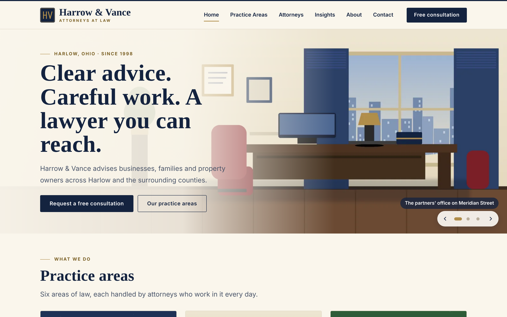
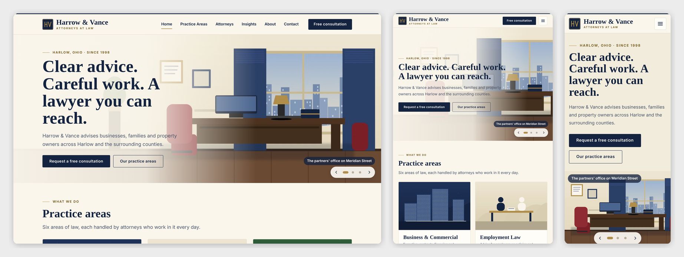

# Harrow & Vance — SkyNet Law Firm Template

A responsive law-firm website template for **ASP.NET Core (.NET 10)**, built on the **SkyNet Framework**.

[](https://dotnet.microsoft.com/)
[](https://www.nuget.org/packages/TheSkyLite.SkyNet)



> **Sample content.** Harrow & Vance, its city (Harlow, Ohio), attorneys, articles and phone numbers are invented placeholders; replace them in the staff area (Settings, Attorneys, Practice areas, Insights, Pages). Every form already saves for real: consultation requests are written to `data/messages.json` and shown in the staff Messages page, and are also mailed if you fill in the `app.mail.*` settings.

## Features

- **19 pages:** 8 public (Home, Practice Areas, Practice Area, Attorneys, Attorney, Insights, About, Contact) and 11 staff (sign-in, Dashboard, Pages, Media library, Practice areas, Attorneys, Insights, Messages, Settings, Activity log, My account)
- **Home slideshow:** office, library and conference room change every 7 seconds, with dots, arrows, swipe, a pause while the pointer is on the controls, and no motion for visitors who ask for reduced motion
- **Practice areas and attorneys:** a page for each area (overview, what we handle, related attorneys) and a profile for each attorney (biography, practice areas, bar admissions, education)
- **Insights:** articles with a topic filter, paging and an article view; the filter and the article open without a page reload and keep working with the browser Back button
- **Free consultation form:** validated on the server, with an acknowledgement that sending it creates no attorney-client relationship, a honeypot and a limit of 3 requests per visitor in 10 minutes
- **One staff account:** Dashboard, a click-to-edit Pages editor with versions, a Media library used by every picture picker, searchable lists with paging, a Messages inbox (New, Read, Replied, Archived), Settings, an Activity log and a password change
- **Responsive:** desktop, tablet and phone layouts; admin lists become cards on phones
- **No front-end build:** plain HTML, CSS and vanilla JavaScript



## Getting started

Requirements: .NET 10 SDK.

    git clone <repo url>
    cd LawFirm
    dotnet run

The SkyNet package (`TheSkyLite.SkyNet`) restores from NuGet. The app opens on **Home**; the staff area is at **/AdminLogin** (every public page has a "Staff sign in" link in the footer).

## Staff account

There is one administrator account and no roles: whoever signs in can use every page of the staff area. There is no Users page.

| Page | What it does |
|---|---|
| Dashboard | counts, latest requests, recent activity |
| Pages | edit the text, pictures and order of the six public pages; Home slides; versions with Restore |
| Media library | upload, rename, replace and delete pictures and videos; used by every picker |
| Practice areas, Attorneys, Insights | add, edit, hide or delete, with search and paging; areas and attorneys can be reordered |
| Messages | consultation requests with the statuses New, Read, Replied and Archived |
| Settings | firm name, address, hours, footer disclaimer, form note, notification email, largest video |
| Activity log | sign-ins, saves, deletions and refusals |
| My account | change the password |

## Run mode

`appConfig/application.cfg` has `app.app.runmode`:

- **0 Demo** (as shipped): the staff sign-in is filled in (`demo` / `demo1234`) and any user name and password signs in as a "Demo manager".
- **1 Production:** only the real account signs in. Set this before you go live.

## Sample data

The site ships with invented records so the Demo looks like a working firm: 6 practice areas, 5 attorneys, 9 articles in 4 topics, 23 pictures in the Media library, content for the 6 public pages and 5 consultation requests (two New, one Read, one Replied, one Archived). The files are `data/site.json`, `areas.json`, `attorneys.json`, `insights.json`, `media.json` and `messages.json`. **Initialize data** removes only the requests, the activity log and the staff account; your pages, areas, attorneys, articles, settings and media stay.

## Going live

1. Set `app.app.runmode | 1` in `appConfig/application.cfg`.
2. Start the site and open **/AdminLogin**. On this first start in Production the site removes every record made in Demo (the sample requests, the activity log and any sessions), keeps your settings, pages and media, writes `data/initialized.txt`, and creates the account with a new first password. This happens once; later starts and mode switches never remove anything.
3. Follow **First sign-in** below.

To remove the sample requests while still in Demo, open **Settings**, **Initialize data**, and type `INITIALIZE`.

## First sign-in (Production)

1. Run the site on your computer and open **/AdminLogin**. The page shows the first user name (`admin`) and a password made just for this site. It is shown only on the computer the site runs on, and is also in `appConfig/initial-admin.txt`.
2. Sign in and choose your own password (at least 8 characters). The box and the file disappear.

Forgot the first password before using it? Delete `appConfig/initial-admin.txt` and `data/staff.json`, then open the sign-in page again. Forgot your own password? Delete `data/staff.json` and open the sign-in page on the server to get a new first password.

Sign-in pauses for a few minutes after 6 wrong passwords for the same user name.

## Email

Consultation requests are always saved in **Messages**. To also receive each one by email, fill in `app.mail.server`, `app.mail.port`, `app.mail.addr`, `app.mail.id` and `app.mail.password` in `appConfig/application.cfg`, and enter the address in **Settings, Send a copy of each request to**. With the placeholder values nothing is sent.

## Deploying

1. Publish with the `web.config` from the project (IIS). Give the application pool Modify on `data/`, `temp/`, `appConfig/` and `images/uploads/` (uploaded media is saved there; `web.config` hides `data/`, so uploaded files must not go there). Use HTTPS.
2. If nobody has signed in yet, read the first password from `appConfig/initial-admin.txt` on the server.
3. Check that `/data/staff.json` and `/appConfig/initial-admin.txt` answer 404 in a browser.
4. Uploads are limited to 8 MB for pictures and, by default, 30 MB for videos (change it in Settings, up to 100); `web.config` and `Program.cs` allow request bodies up to 110 MB.

> **Redeploying:** publishing copies `data/` and `images/uploads/` over the live files. Download the live folders first or leave them out of the publish.

## Project structure

    LawFirm/
    ├─ appConfig/application.cfg      run mode, mail, placeholder secrets
    ├─ codes/                         one class per page, plus
    │  ├─ Core/                       Store, Auth, Ui, Media, Blocks, Init, Mailer, Local
    │  └─ Models/LawFirmModel.cs      records and the page-block model
    ├─ htmls/  scripts/  styles/      one file per page
    ├─ data/                          site.json, areas, attorneys, insights, media, messages
    ├─ images/                        painted artwork (WebP); uploads go to images/uploads/
    └─ docs/                          README screenshots

### One page = four files, one name

| File | Holds |
|---|---|
| `codes/[Page].cs` | the page class and its server methods |
| `htmls/[Page].html` | markup with `{plhd_*}` placeholders |
| `scripts/[Page].js` | one IIFE namespace, `[Page]Js` |
| `styles/[Page].css` | styles, every class prefixed (`hm-`, `pa-`, `pd-`, `at-`, `ap-`, `in-`, `ab-`, `ct-`, and one prefix per staff page) |

The project has 17,000 lines of code across 19 pages and 23 pictures (each with a thumbnail).

## SkyNet in action

The contact form collects the fields and calls the server; the server validates and answers with the parts of the page to change.

```javascript
function send() {
    $ApiRequest('Contact/Submit', JSON.stringify([
        { key: 'name', vlu: val('ct-name') },
        { key: 'email', vlu: val('ct-email') },
        { key: 'msg', vlu: val('ct-msg') },
        { key: 'ack', vlu: el('ct-ack').checked ? '1' : '' }
    ]));
    return false;
}
```

```csharp
public async Task<ApiResponse> Submit()
{
    ApiResponse response = new ApiResponse();
    string eEmail = !Ui.IsEmail(GetDataValue("email")) ? "Please enter a valid email address." : string.Empty;
    response.SetElementContents("ct-e-email", eEmail);
    ...
    response.SetElementContents("ct-sent", "<b>Thank you.</b> We have your request.");
    return response;
}
```

| Page | Request | Response |
|---|---|---|
| Contact | `Submit` | field errors, or the confirmation; the request is saved to Messages |
| Insights | `Filter`, `Open` | replaces the article list or opens an article in place |
| Attorneys | `Filter` | replaces the chips and the list |
| AdminPages | `Save`, `Versions`, `Restore` | checks every block and link, saves, lists versions |
| AdminMessages | `Open`, `SetStatus`, `Delete` | opens a request, changes its status, removes it |

## Customize it

- **Content:** use the staff area (Pages, Practice areas, Attorneys, Insights, Settings), or edit `data/*.json`
- **Brand name, address and disclaimer:** Settings
- **Colors and fonts:** the variables at the top of each public stylesheet (`--hm-navy`, `--hm-brass`, `--hm-ivory`, `--hm-head`, `--hm-text`)

## License

- **This template:** MIT — free to use, modify and redistribute, including commercially.
- **SkyNet Framework** (`TheSkyLite.SkyNet` NuGet package): proprietary, free to use including commercial use; see the license included in the package.

Both parts are in the `LICENSE` file at the project root.
